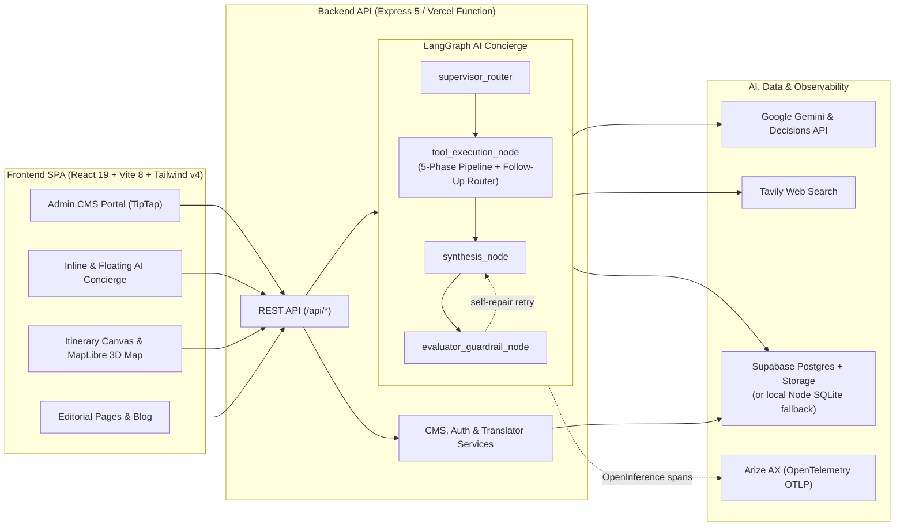

# Khám Phá Đắk Lắk — Trái Tim Tây Nguyên

> A full-stack, bilingual (**Vietnamese / English**) editorial travel platform, interactive map-backed itinerary planner, **LangGraph + Gemini** AI travel concierge, headless editorial CMS, and agent-friendly CLI showcasing Đắk Lắk in Vietnam's Central Highlands.

[](https://nodejs.org/)
[](https://react.dev/)
[](https://www.typescriptlang.org/)
[](https://langchain-ai.github.io/langgraphjs/)
[](https://supabase.com/)
[](https://vercel.com/)

---

## Table of Contents

- [Overview](#overview)
- [Key Features](#key-features)
- [Architecture](#architecture)
- [Tech Stack](#tech-stack)
- [Project Structure](#project-structure)
- [Getting Started](#getting-started)
- [Environment Variables](#environment-variables)
- [CMS CLI Workflow](#cms-cli-workflow)
- [API Reference](#api-reference)
- [Testing & AI Evaluations](#testing--ai-evaluations)
- [Deployment (Supabase + Vercel)](#deployment-supabase--vercel)

---

## Overview

**Khám Phá Đắk Lắk** is an individual full-stack and AI engineering project built around the culture, specialty coffee heritage, basalt highlands, and ethical ecotourism of Đắk Lắk Province. It combines:

1. **An editorial travel showcase** with a custom Central Highlands design system (Deep Forest `#132A1E`, Warm Dó Paper `#F7F3EB`, Coffee Amber `#D48C46`, Basalt Terracotta `#8C3B2B`).
2. **An agentic AI travel concierge** orchestrated with LangGraph, Google Gemini, Gemini Decisions API (`gemini-decision-1`), and Tavily live web search to verify local ticket prices, respect budget constraints, and enforce ethical wildlife tourism guidelines.
3. **An interactive itinerary canvas & 3D vector map** powered by MapLibre GL and OpenFreeMap with route leg calculations, budget breakdowns, and deep links to Google Maps.
4. **A bilingual editorial CMS & CLI** supporting role-based publishing workflows (`draft → in_review → published`), rich-text editing, Gemini auto-translation, and Markdown-first authoring for both humans and AI agents.

---

## Key Features

### Editorial Travel Experience (VI / EN)
- **Bilingual SPA** with instant Vietnamese / English switching across UI, itineraries, and CMS-backed articles.
- **Curated Sections**: Hero showcase, Bento Overview (`bento`), Red Earth Stories (`stories`), Four Seasons interactive video/canvas showcase, editorial preview modal, and dedicated `/blog/:slug` article pages with pull quotes and cultural glossaries.
- **Built-in Design System Drawer**: Inspect and copy the project's CSS custom properties, color palette, and typography tokens directly from the app.

### Agentic AI Travel Concierge
- **LangGraph State Machine**: 4-node graph (`supervisor_router → tool_execution_node → synthesis_node → evaluator_guardrail_node`) with session memory (`MemorySaver`) and automatic self-repair retries when guardrail checks fail.
- **4 Specialized Agent Tools**:
  - `search_local_daklak_catalog` — queries curated places, presets, and published CMS posts.
  - `search_live_web_tavily` — fetches real-time local ticket prices, opening hours, and travel Q&A via Tavily.
  - `update_trip_intake` — extracts and validates structured trip constraints (`travelers`, `dates`, `duration`, `budget`, `theme`, `intent`).
  - `plan_or_modify_itinerary` — runs the 5-phase planning pipeline or applies targeted follow-up edits.
- **5-Phase Planning Pipeline**:
  1. **Phase 1 — Intake & Clarification**: Detects intent (`general_qa`, `plan_trip`, `modify_stops`) and surfaces quick clarification chips if essential constraints are missing.
  2. **Phase 2 — Capacity & Logistics**: Matches group size and budget tier to accommodations and transport modes (assisted by Gemini Decisions `decideLogisticsAndStay`).
  3. **Phase 3 — Budget & Live Price Verification**: Applies VND policy guardrails (lodging ≤ 40%, transit ≤ 25%, 10% contingency buffer), reads cached `place_prices` (168-hour TTL), and verifies fresh prices with Tavily.
  4. **Phase 4 — Purpose-Aligned Ranking**: Ranks destinations by theme fit (`coffee`, `culture`, `nature`, `cuisine`), geographic cluster, and calibrated Gemini Decisions scoring (`decidePlaceFitScores`).
  5. **Phase 5 — Synthesis & Ethical Guardrails**: Generates day-by-day stops, expense items, and citations while enforcing **ethical wildlife standards** (strictly prohibiting elephant riding and recommending ethical observation tours at Yok Đôn National Park) via deterministic checks and `decideEthicalWildlifePolicy`.
- **Follow-Up Editing & Offline Fallback**: Supports iterative edits (add/remove/swap stops, optimize route order, change budget/theme) and degrades gracefully to a deterministic local fallback when external API keys are not configured.

### Interactive Trip Canvas & 3D Map
- **Itinerary Canvas Modal**: Day-by-day schedule editor, route distance metrics, categorized VND expense tracker (`stay`, `transit`, `food`, `activity`), and one-click clipboard export.
- **MapLibre GL + OpenFreeMap**: Switchable vector map styles (`3D Liberty`, `Bright Street`, `Positron Minimal`), 3D pitch toggle, per-day route filtering, numbered stop markers, place preview cards, and direct Google Maps navigation links.

### Bilingual CMS (`/admin`) & Agent-Friendly CLI
- **Role-Based Editorial Workflow**: `admin` and `writer` accounts with HTTP-only cookie and Bearer token authentication, submission/review notes, drag-order sorting, and user management (`/admin/users`).
- **Rich Text & Media**: TipTap 3 editor with XSS sanitization (`sanitize-html` & `DOMPurify`) and image uploads (JPG, PNG, WebP, GIF up to 4 MB) to Supabase Storage or local `/uploads`.
- **Gemini Auto-Translation**: One-click Vietnamese-to-English editorial translation preserving HTML markup, proper nouns, and cultural terms, plus manual English overrides.
- **CMS CLI (`daklak-cms`)**: Markdown-first bilingual authoring with automatic media upload, schema validation, and JSON output.

### Observability & Evaluations
- **Arize AX + OpenTelemetry**: Emits OpenInference-compliant OTLP traces for LangGraph nodes, LLM calls, Gemini Decisions calls, tool invocations, and guardrail evaluations.
- **Trace & Feedback Persistence**: Stores structured run traces in `ai_traces` (Supabase or SQLite), supports user thumbs-up/down feedback (`POST /api/ai/feedback`), and exposes admin trace inspection (`GET /api/ai/traces`).

---

## Architecture



---

## Tech Stack

| Layer | Technologies |
| --- | --- |
| **Frontend** | React 19, TypeScript 7, Vite 8, Tailwind CSS v4, React Router 7, MapLibre GL (`react-map-gl`), TipTap 3, FontAwesome 7, DOMPurify |
| **Backend** | Node.js 24, Express 5, Zod 4, Multer, `sanitize-html`, esbuild (ESM API bundler) |
| **AI & Search** | `@langchain/langgraph`, `@langchain/google-genai`, `@google/genai` (Gemini & `gemini-decision-1`), `@tavily/core` |
| **Database & Storage** | Supabase (PostgreSQL + RLS + Storage bucket `uploads`), automatic fallback to Node built-in `node:sqlite` + local disk |
| **Observability** | OpenTelemetry SDK, `@arizeai/openinference-core`, `@arizeai/openinference-semantic-conventions`, Arize AX OTLP Exporter |
| **Deployment** | Vercel (static Vite build + Node 24 Serverless Function at `api/index.mjs`) |

---

## Project Structure

```text
dak-lak/
├── api/                         # Vercel serverless entrypoint (loads server/bundle/app.mjs)
├── cli/                         # Agent-friendly bilingual CMS CLI (`npm run cms`)
│   ├── commands/                # auth, context, media, posts, users commands
│   └── README.md                # Detailed CLI documentation
├── docs/                        # Design system report, prototype HTML, demo media
├── public/                      # Static assets (logo/favicon)
├── scripts/
│   ├── build-api.mjs            # Bundles Express server to ESM for Vercel Node 24
│   └── run-arize-experiment.ts  # Runs LangGraph concierge over Arize eval datasets
├── server/
│   ├── app.ts                   # Express app setup, health check, route mounting
│   ├── config.ts                # Env loading, DB/AI/Tavily/Arize configuration
│   ├── db/                      # Dual database layer (Supabase + node:sqlite) & seeders
│   ├── routes/                  # auth, publicPosts, adminPosts, adminUsers, upload, ai
│   └── services/
│       ├── ai/                  # LangGraph agent, 5-phase pipeline, Gemini Decisions,
│       │                        # Tavily lookup, evaluator, translator, Arize telemetry
│       ├── cms/                 # Post/user services and mappers
│       └── core/                # Auth/sessions, HTML sanitization, slugify, errors
├── src/
│   ├── components/              # landing/, planner/, ai/, cms/, layout/
│   ├── context/                 # Global AppContext (lang, planner state, chat, modals)
│   ├── data/                    # Static catalog, places directory, seasons, i18n dictionary
│   ├── pages/                   # BlogPostPage and admin/ portal pages
│   ├── services/                # Typed frontend API clients (aiApi, cmsApi)
│   └── utils/                   # Google Maps helpers, route metrics, YouTube, clipboard
├── supabase/
│   └── migrations/              # PostgreSQL schema, indexes, RLS & storage bucket SQL
├── tests/                       # Node test suites (AI phases, follow-up, evals, CLI, markdown)
│   └── fixtures/                # Golden test cases & Arize evaluation dataset
├── vercel.json                  # Vercel build, function config, and SPA/API rewrites
└── vite.config.ts               # Vite config with /api & /uploads dev proxy
```

---

## Getting Started

### Prerequisites

- **Node.js `24.x`** (required for `engines` and the built-in `node:sqlite` local fallback)
- **npm** (comes with Node.js)

### 1. Install Dependencies

```bash
git clone https://github.com/nguyenhai2k4/dak-lak-travel.git
cd dak-lak-travel
npm install
```

### 2. Configure Environment (Optional for Local Quick Start)

Copy `.env.example` to `.env`:

```bash
cp .env.example .env
```

> **Zero-config local mode**: If `SUPABASE_URL` / `SUPABASE_SECRET_KEY` are omitted, the server automatically initializes and seeds a local SQLite database (`server/data/daklak.db`) and serves uploads from `server/uploads/`. If `GEMINI_API_KEY` is omitted, the AI concierge runs in deterministic local fallback mode.

### 3. Run the Development Servers

```bash
npm run dev
```

This runs both servers concurrently:
- **Frontend (Vite)**: `http://localhost:5173` (proxies `/api` and `/uploads` to `:4000`)
- **Backend (Express + tsx watch)**: `http://localhost:4000`

### Default Seeded CMS Accounts

When seeding a fresh database, two default accounts are created (override via `CMS_ADMIN_*` / `CMS_WRITER_*` env vars):

| Role | Email | Password | Portal URL |
| --- | --- | --- | --- |
| **Admin** | `admin@daklak.travel` | `Admin@123` | `http://localhost:5173/admin/login` |
| **Writer** | `writer@daklak.travel` | `Writer@123` | `http://localhost:5173/admin/login` |

### Available npm Scripts

| Script | Description |
| --- | --- |
| `npm run dev` | Run Express API (`:4000`) and Vite SPA (`:5173`) concurrently |
| `npm run dev:web` | Run Vite frontend dev server only |
| `npm run dev:server` | Run Express backend with `tsx watch` only |
| `npm run cms -- <args>` | Run the bilingual CMS CLI |
| `npm test` | Run all unit & integration tests (`tests/*.test.ts`) |
| `npm run eval:ai` | Run AI guardrail, golden-case, and telemetry evaluation tests |
| `npm run build` | Type-check (`tsc -b`), build Vite SPA (`dist/`), and bundle API (`server/bundle/app.mjs`) |
| `npm run build:api` | Bundle the Express API into pure ESM for Vercel Node 24 |
| `npm start` | Start standalone production server serving both API and `dist/` |
| `npm run preview` | Preview built Vite frontend locally |

---

## Environment Variables

See [`.env.example`](.env.example) for the complete template.

| Variable | Required | Default | Description |
| --- | --- | --- | --- |
| `SUPABASE_URL` | Prod | — | Supabase project URL (enables Postgres + Storage mode) |
| `SUPABASE_SECRET_KEY` | Prod | — | Supabase service/secret key (`SUPABASE_SERVICE_ROLE_KEY` also accepted) |
| `SUPABASE_PUBLISHABLE_KEY` | Optional | — | Supabase publishable/anon key |
| `SUPABASE_STORAGE_BUCKET` | Optional | `uploads` | Public Storage bucket for CMS images |
| `GEMINI_API_KEY` | For AI | — | Google Gemini API key (powers AI Concierge & CMS auto-translation) |
| `GEMINI_MODEL` | Optional | `gemini-2.5-flash` | Primary Gemini model (`.env.example` sets `gemini-3.8-flash`) |
| `GEMINI_DECISION_MODEL` | Optional | `gemini-decision-1` | Gemini Decisions API model (`off`/`none`/`false` disables it) |
| `TAVILY_API_KEY` | Optional | — | Enables live web search for ticket prices & Q&A verification |
| `TAVILY_TIMEOUT_MS` | Optional | `10000` | Tavily request timeout in milliseconds |
| `TAVILY_SEARCH_DEPTH` | Optional | `basic` | Tavily search depth (`basic`, `advanced`, `fast`, `ultra-fast`) |
| `TAVILY_INCLUDE_ANSWER` | Optional | `true` | Include Tavily summarized answer (`true`, `false`, `basic`, `advanced`) |
| `TAVILY_MAX_RESULTS` | Optional | `5` | Max search results per Tavily query (`1–10`) |
| `TAVILY_COUNTRY` | Optional | `vietnam` | Country bias for Tavily results |
| `AI_PRICE_TTL_HOURS` | Optional | `168` | Cache TTL (hours) for verified `place_prices` records |
| `AI_CHAT_TIMEOUT_MS` | Optional | `30000` | AI chat turn timeout in milliseconds |
| `AI_RESPONSE_MAX_TOKENS` | Optional | `4096` | Max response tokens for LLM synthesis |
| `ARIZE_API_KEY` | Optional | — | Arize AX API key for OpenTelemetry OTLP export |
| `ARIZE_SPACE_ID` | Optional | — | Arize AX Space ID |
| `ARIZE_PROJECT_NAME` | Optional | `dak-lak-travel-concierge` | Arize AX project name |
| `ARIZE_COLLECTOR_ENDPOINT` | Optional | `https://otlp.arize.com` | Arize AX OTLP collector URL |
| `CMS_PORT` | Optional | `4000` | Local Express server port |
| `AI_CHAT_RATE_LIMIT_MAX` | Optional | `30` | Max AI chat requests per IP per 5-minute window |

---

## CMS CLI Workflow

The project ships with an agent-friendly CLI (`daklak-cms` / `npm run cms`) that works against a running server (`--http`) or directly against local SQLite (`--local`). See [`cli/README.md`](cli/README.md) for the full guide.

```bash
# Check CMS health and post counts
npm run cms -- status --json

# Inspect existing posts, categories, locations, and schema presets
npm run cms -- context --json

# Scaffold a bilingual Markdown draft (with <!-- LANG:EN --> section)
npm run cms -- post template --section stories --theme coffee --bilingual --out draft.md

# Validate frontmatter, slug, word count, media, and translation readiness
npm run cms -- post validate draft.md --json

# Push post, upload local image references, and submit for editorial review
npm run cms -- post push draft.md --upload-media --submit --json

# Publish as admin
npm run cms -- post review <id-or-slug> --action publish --json
```

---

## API Reference

| Group | Method & Endpoint | Auth | Description |
| --- | --- | --- | --- |
| **Health** | `GET /api/health` | Public | Server liveness & active DB backend (`supabase` or `sqlite`) |
| **Auth** | `POST /api/auth/login` | Public | Login with email/password (sets cookie & returns Bearer token) |
| **Auth** | `POST /api/auth/logout` | Session | Revoke session and clear cookie |
| **Auth** | `GET /api/auth/me` | Session | Return authenticated user profile |
| **Public CMS** | `GET /api/posts?lang=vi\|en&section=...` | Public | List published posts localized by language |
| **Public CMS** | `GET /api/posts/:slug?lang=vi\|en&preview=1` | Public / Auth | Fetch post by slug (`preview=1` allows authenticated draft preview) |
| **Admin CMS** | `GET /api/admin/posts`, `POST /api/admin/posts` | Auth | List or create posts |
| **Admin CMS** | `GET /api/admin/posts/context` | Auth | Editorial stats, categories, locations & schema context |
| **Admin CMS** | `GET / PUT / DELETE /api/admin/posts/:id` | Auth | Read, update, or delete a post |
| **Admin CMS** | `POST /api/admin/posts/:id/submit` | Auth | Submit draft for editorial review (`in_review`) |
| **Admin CMS** | `POST /api/admin/posts/:id/review` | Admin | Approve/publish or request revisions with review note |
| **Admin CMS** | `POST /api/admin/posts/:id/retranslate` | Admin | Auto-translate Vietnamese post to English via Gemini |
| **Admin CMS** | `POST /api/admin/posts/:id/translation` | Auth | Save a manual/AI-agent English translation |
| **Admin CMS** | `PATCH /api/admin/posts/reorder` | Admin | Reorder posts within a section (`bento` / `stories`) |
| **Uploads** | `POST /api/admin/uploads` | Auth | Upload image (`multipart/form-data`, field `image`, max 4 MB) |
| **Users** | `GET / POST /api/admin/users`, `PATCH /api/admin/users/:id` | Admin | Manage CMS users and roles |
| **AI Concierge** | `GET /api/ai/status` | Public | Check configured Gemini/Decisions/Tavily engine & tool list |
| **AI Concierge** | `POST /api/ai/chat` | Public (Rate-limited) | Run a LangGraph AI Concierge turn |
| **AI Concierge** | `POST /api/ai/feedback` | Public | Submit thumbs-up (`1`) / thumbs-down (`-1`) feedback on a trace |
| **AI Concierge** | `GET /api/ai/traces` | Admin | List persisted AI run traces with status/intent filters |

---

## Testing & AI Evaluations

All tests run against isolated temporary SQLite databases (no external credentials required):

```bash
# Run the full test suite (AI phases, follow-up routing, evals, CLI, markdown)
npm test

# Run AI evaluation, guardrail, and Arize telemetry tests only
npm run eval:ai
```

### Running Arize AX Batch Experiments

You can run the real LangGraph concierge against an exported Arize dataset (or `tests/fixtures/arize-eval-dataset.json`) to produce structured experiment run outputs:

```bash
npx tsx scripts/run-arize-experiment.ts --input tests/fixtures/arize-eval-dataset.json --output runs.json
```

---

## Deployment (Supabase + Vercel)

### 1. Provision Supabase

Apply the initial migration SQL in [`supabase/migrations/20261120000000_init_daklak_schema.sql`](supabase/migrations/20261120000000_init_daklak_schema.sql) via the Supabase CLI or SQL Editor. It creates:
- Tables: `users`, `sessions`, `posts`, `stays`, `logistics`, `place_prices`, `ai_traces`
- Performance indexes and Row Level Security (RLS) locked down for server-side access
- Public `uploads` Storage bucket (5 MB limit, image MIME types)

Seed data (`users`, `posts`, `stays`, `logistics`, `place_prices`) is automatically populated on the first API request if the tables are empty.

### 2. Deploy to Vercel

The repository is preconfigured with [`vercel.json`](vercel.json):
- **Build Command**: `npm run build` (builds Vite static assets to `dist/` and bundles the Express app to `server/bundle/app.mjs` with Node 24 ESM compatibility)
- **Serverless Function**: `api/index.mjs` (`maxDuration: 60`, bundling `server/bundle/**`)
- **Rewrites**: `/api/(.*)` → `/api/index`, all other routes → `/index.html`

Set your production environment variables (`SUPABASE_URL`, `SUPABASE_SECRET_KEY`, `GEMINI_API_KEY`, and optionally `TAVILY_API_KEY`, `ARIZE_API_KEY`, `ARIZE_SPACE_ID`) in the Vercel Project Settings, then deploy.
